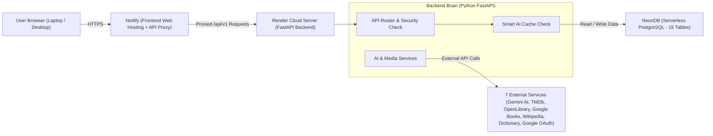
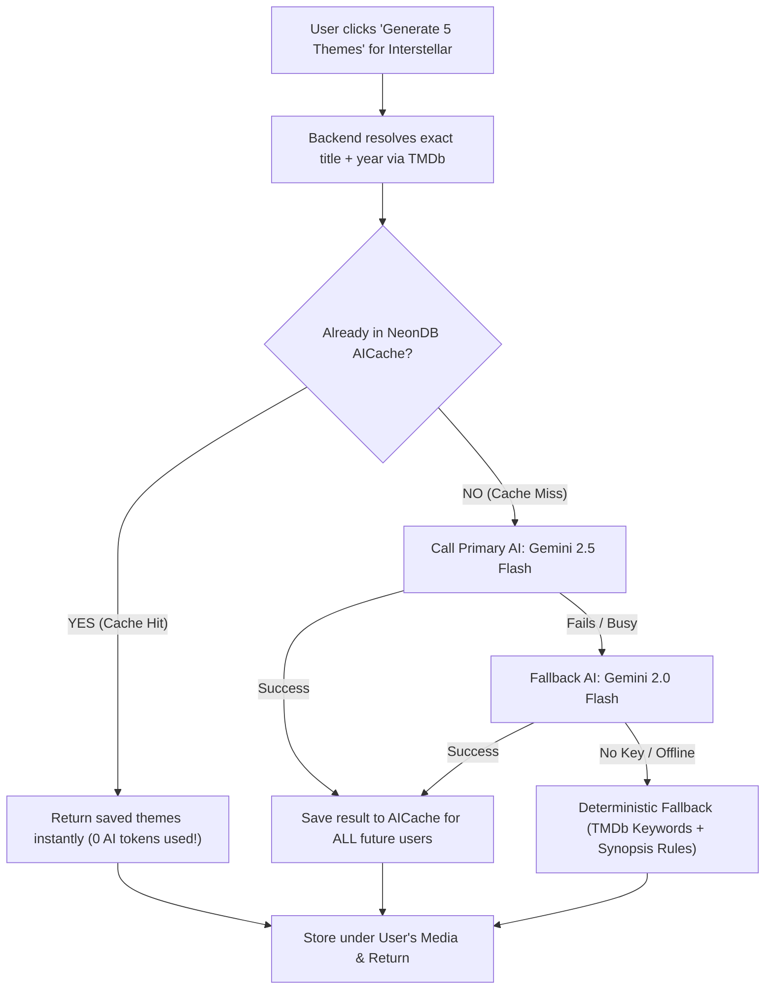
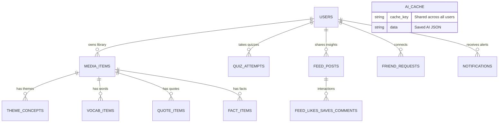

# ZIST — Final Presentation Deck & Web Architecture

> **How to use this file:** Copy the **On-Slide Text** directly into PowerPoint, Google Slides, or Canva, and use the **Speaker Notes** as your script when presenting to Ma'am. Every technical concept is explained in plain English without heavy code jargon.

---

## Deck Overview (12 Slides)

1. **Slide 1:** Title Slide — *ZIST: From Credits Roll to Brain Fuel*
2. **Slide 2:** The Origin Story (Featuring Ma'am's Question!)
3. **Slide 3:** The Problem & Solution — *Beating "Credits-Roll Amnesia"*
4. **Slide 4:** What ZIST Actually Does (Live Feature Walkthrough)
5. **Slide 5:** The Big Picture — *3-Tier Cloud Architecture*
6. **Slide 6:** The Tech Stack (Plain-English Breakdown)
7. **Slide 7:** Frontend — *What the User Sees & Feels*
8. **Slide 8:** Backend & AI Pipeline — *The Smart Kitchen Behind the Scenes*
9. **Slide 9:** The 7 External APIs — *Why Reinvent the Wheel?*
10. **Slide 10:** NeonDB Database — *15 Connected Filing Cabinets in the Cloud*
11. **Slide 11:** Security & Auth Layer — *Locks, Badges & Honest Engineering Notes*
12. **Slide 12:** Deployment, Challenges & Future Roadmap

---

## Slide 1: Title Slide

### On-Slide Text
# ZIST — Your Learning Compass
### *Watch it. Read it. Actually remember it.*
- **Course:** Software Development Project
- **Platform:** Full-Stack AI-Assisted Web Application

### Speaker Notes
> "Good afternoon Ma'am and everyone. Today I'm presenting **ZIST**, a web application I built to turn the movies we watch and books we read into lasting knowledge. Before I show you a single diagram or database table, I want to start with a quick story — and actually, Ma'am, you are part of this story."

---

## Slide 2: The Origin Story (Addressing Ma'am's Joke!)

### On-Slide Text
# "Who is going to go through the hassle of learning from a movie after watching it?"
— *Ma'am, earlier this semester* 😄

### My Honest Counter-Argument:
- You're right — **nobody** wants homework after watching *Interstellar* or *Inception*.
- If you have to pause a movie, open Wikipedia, search a dictionary, and write notes in a diary... **you just won't do it.**
- **So I asked a different software question:**
  > *What if the software did 90% of the heavy lifting in 3 seconds — while you're still finishing your popcorn?*

### Speaker Notes
> "When I first pitched this idea, Ma'am laughed and asked a very fair question: *'Who is actually going to go through the hassle of learning from a movie after watching it?'*
> And honestly, Ma'am — I completely agreed with you at first! After a two-hour movie, nobody wants to open four browser tabs, read Wikipedia articles, look up hard words, and write essays.
> That joke is actually what shaped the entire software design of ZIST. My goal became: **zero hassle**. You type one movie or book title, click once, and the system automatically pulls the themes, new vocabulary, iconic quotes, and even builds a 2-minute quiz for later. You just sit back and tap what interests you."

---

## Slide 3: The Problem — "Credits-Roll Amnesia"

### On-Slide Text
# Why We Forget 90% of Great Stories
- We consume **hours** of rich movies, series, documentaries, and books every week.
- Great ideas, deep themes, and new vocabulary flash by — **and vanish by Tuesday morning.**
- Existing tools are disconnected:
  - IMDb / Letterboxd $\rightarrow$ just ratings & watchlists
  - Notion / Notes apps $\rightarrow$ blank pages that require manual typing
  - Flashcard apps $\rightarrow$ feel like studying for an exam

### The ZIST Solution
**One unified learning workspace** that automatically turns your entertainment library into themes, vocabulary, quotes, quizzes, analytics, and social discussions.

### Speaker Notes
> "Think about the last great movie or book you finished. You probably heard a brilliant quote, encountered a word you didn't quite know, or noticed a deep theme — and three days later, you can barely remember the main character's name. Existing apps either just let you rate movies or give you an empty notepad. ZIST bridges that gap automatically."

---

## Slide 4: Product Tour — How a User Uses ZIST

### On-Slide Text
# 5 Core Experiences in One Web App
1. **Smart Discovery & Library:** Type a title $\rightarrow$ auto-fetches posters, creators, release years, and descriptions.
2. **Deep Media Notebook:**
   - **Themes:** AI-extracted core ideas + Wikipedia summaries + your own reflection.
   - **Vocabulary:** Auto-fetched dictionary definitions or AI-curated words from the story.
   - **Quotes & Facts:** Memorable lines with AI-explained deeper meanings + context notes.
3. **Quiz Hub:** Auto-generated multiple-choice quizzes (single title or across your whole library).
4. **Learning Insights:** Visual charts tracking study streaks, vocabulary growth, and knowledge depth.
5. **Social Community:** Share favorite quotes/themes to a *Global* or *Friends-only* feed, like, comment, and get notifications.

### Speaker Notes
> "Here is what the web app looks like for a user. When you add a movie or book, ZIST brings in all the metadata automatically. Inside each title, you get four clean tabs: Themes, Vocabulary, Quotes, and Overview. You can test yourself in the Quiz Hub, track your progress with visual charts on the Insights page, and share your favorite takeaways with friends on the Feed."

---

## Slide 5: System Architecture (The Big Picture)

### Visual Diagram (Copy into Mermaid / Draw.io / Slides)

### On-Slide Text
# 3-Tier Client–Server Architecture
- **Tier 1 — Presentation (Frontend on Netlify):** The visual website running in the browser.
- **Tier 2 — Application Logic (Backend on Render):** Handles rules, security checks, AI prompts, and API orchestration.
- **Tier 3 — Data & Identity (NeonDB Cloud):** Stores all user profiles, libraries, social posts, and cached AI knowledge.

*Analogy:* **Frontend** is the restaurant dining room, **Backend** is the kitchen, **APIs** are the waiters carrying orders, and **NeonDB** is the pantry & ledger.

### Speaker Notes
> "From a software engineering standpoint, ZIST follows a clean **3-tier decoupled architecture**.
> The **Frontend** lives on Netlify — that's what you see and click in the browser. Whenever it needs data, it sends a request through Netlify's proxy to our **Backend** running on Render. The Backend acts like the brain: it checks who you are, talks to external services like Google Gemini or movie databases, and stores everything safely inside **NeonDB**, our cloud PostgreSQL database. Separating these three layers means each part can scale, update, or be maintained independently."

---

## Slide 6: Complete Technology Stack (At a Glance)

### On-Slide Text

| Layer | Technologies Used | Why This Choice? |
| --- | --- | --- |
| **Frontend (UI)** | React 18, TypeScript, Vite, Tailwind CSS, shadcn/ui, Recharts | Fast, responsive, type-safe UI with accessible components and interactive charts |
| **Backend (API)** | Python 3.13, FastAPI, Uvicorn, Pydantic v2, httpx | High-speed async Python server with automatic data validation and API docs |
| **Database (ORM)** | Neon Serverless PostgreSQL, SQLAlchemy 2.0, psycopg | Cloud Postgres that scales cleanly; SQLAlchemy prevents raw SQL mistakes |
| **AI & Data** | Google Gemini (`2.5-flash` / `2.0-flash`), TMDb, OpenLibrary, Google Books, Wikipedia, Free Dictionary | Zero manual typing — rich facts, covers, definitions, and thematic analysis |
| **Security & Auth** | JWT (`HS256` & `JWKS`), PBKDF2-SHA256, Google OAuth 2.0, CORS | Industry-standard token verification, encrypted passwords, and origin control |
| **Hosting & DevOps** | Netlify, Render, Neon Cloud, Docker & Nginx | Free/low-cost cloud hosting in production + consistent containers locally |

### Speaker Notes
> "Here is our complete tech stack. On the frontend, we used **React with TypeScript and Tailwind CSS** so the interface stays clean, modern, and bug-resistant. On the backend, we chose **Python and FastAPI** — Python is ideal because it works seamlessly with AI and external APIs, and FastAPI is super fast and validates every incoming request automatically. Everything is persisted in **NeonDB**, a serverless PostgreSQL cloud database."

---

## Slide 7: Frontend Architecture — Built for Flow

### On-Slide Text
# Designed Like a Streaming App, Not a Textbook
- **18 Organized Routes:**
  - *Public:* Editorial Dark Landing Page, Login, Sign Up, Forgot Password.
  - *Protected App:* Home Dashboard, Feed, Library, Add Media, Media Detail, Vocabulary, Quiz Hub, Insights, Friends, Profiles.
- **Dual Theme System:**
  - Sleek **editorial dark** marketing pages (`#080909` + cyan accents)
  - Switchable **Light & Dark glassmorphic mode** inside the app (saved in browser storage before page paint so there's no white flash).
- **Smart User Experience Engineering:**
  - **Cold-Start Protection:** Retries profile sync automatically (`0.2s` $\rightarrow$ `0.5s` $\rightarrow$ `1s` $\rightarrow$ `2s`) if the cloud backend is waking up from sleep.
  - **Polite Notification Polling:** Checks unread notifications every 60 seconds, and automatically pauses when the browser tab is hidden.
  - **Custom Avatars:** 8 built-in mascot characters, instant initials generator, or client-side compressed photo uploads.

### Speaker Notes
> "A big part of answering Ma'am's question — *'why wouldn't it feel like a chore?'* — is the frontend design. We intentionally designed the Dashboard with horizontal poster rails like Netflix so it feels inviting, not like a spreadsheet.
> Under the hood, we also engineered practical reliability features: for instance, cloud servers on Render can take a second or two to wake up if nobody used them recently. Instead of showing an error screen, our frontend silently retries up to four times with exponential backoff so the user never notices."

---

## Slide 8: Backend & The Smart AI Caching Pipeline

### Visual Diagram (How ZIST Saves AI Cost & Speeds Up Responses)

### On-Slide Text
# Inside the Backend (`FastAPI`)
- **Modular Structure:** Separates API routes, validation rules (Pydantic), database models, and external services cleanly.
- **60+ REST Endpoints** covering Auth, Media Library, Themes, Facts, Vocab, Quotes, Quizzes, Social Feed, Friends, Notifications, Insights, and External Search.
- **3-Layer AI Resilience (Zero Crashes, Lower Cost):**
  1. **Disambiguation First:** Fetches official synopsis, director, year, and keywords from TMDb *before* asking Gemini, preventing AI hallucinations on remakes or identically named titles.
  2. **Shared `AICache` Table:** If User A generates themes for *Interstellar*, User B gets them instantly from NeonDB at **zero AI cost**.
  3. **Graceful Degradation:** Primary AI (`gemini-2.5-flash`) $\rightarrow$ Backup AI (`gemini-2.0-flash`) $\rightarrow$ Keyword/Text fallback if AI is completely offline.

### Speaker Notes
> "This slide shows one of my favorite engineering decisions in the backend. Calling an AI like Gemini for every user on every click would be slow and expensive — and AI can also hallucinate if two movies share the same name.
> So first, our backend checks TMDb to get the exact movie's year, director, and official plot. Next, it checks a shared **AI Cache** table in NeonDB. If *anyone* has already generated themes, vocabulary, or quotes for that exact movie, ZIST serves it in milliseconds using **zero AI tokens** — basically smart laziness! And if Gemini is ever down, a backup model or deterministic keyword engine steps in so the app never crashes."

---

## Slide 9: External APIs — Powering Automation Without Manual Typing

### On-Slide Text
# 7 External APIs Orchestrated by the Backend

| Service | Role in ZIST | Smart Enhancement |
| --- | --- | --- |
| **Google Gemini API** | Generates themes, contextual vocabulary, quotes, quote meanings & quiz wrong-answers | Structured JSON output + anti-hallucination prompt rules |
| **TMDb v3 API** | Searches movies & TV shows; grabs posters, ratings, directors, genres & keywords | Runs parallel requests so results load fast |
| **OpenLibrary API** | Searches books & fetches cover art + descriptions | Retries 3 query styles automatically |
| **Google Books API** | Automatic backup if OpenLibrary misses a book | Keeps book search reliable |
| **Wikipedia APIs** | Fetches theme definitions & suggests themes from article analysis sections | Cleans HTML/citations into readable summaries |
| **Free Dictionary API** | Instant word definitions, parts of speech & example sentences | Auto-fills as you type a word |
| **Google OAuth & Neon JWKS** | Third-party sign-in & public-key token verification | Keeps credentials off our forms |

### Speaker Notes
> "Instead of building a movie encyclopedia or dictionary from scratch, ZIST acts as an **API orchestrator** — calling 7 different external services through the backend. For example, when you search for a title on the Add Media page, the backend queries TMDb for movies/TV and OpenLibrary for books **at the exact same time** in parallel. If OpenLibrary doesn't find a book, it quietly falls back to Google Books before returning clean, unified cards to the frontend."

---

## Slide 10: NeonDB Database Architecture (15 Relational Tables)

### Visual Diagram (Simplified Data Relationships)

### On-Slide Text
# Why Neon Serverless PostgreSQL?
- **15 Normalized Tables** grouped across 4 domains:
  1. **Identity & Social (4 tables):** `users`, `user_follows`, `friend_requests`, `notifications`
  2. **Learning Library (6 tables):** `media_items`, `theme_concepts`, `fact_items`, `vocab_items`, `quote_items`, `quiz_attempts`
  3. **Community Feed (4 tables):** `feed_posts`, `feed_post_likes`, `feed_post_saves`, `feed_post_comments`
  4. **Performance Layer (1 table):** `ai_cache`
- **Cloud-Native Reliability Tuning:**
  - Enforces **SSL encryption** (`sslmode=require`) and **TCP keepalives**.
  - **Pre-ping & Connection Recycling:** Serverless databases sleep when idle; `pool_pre_ping` checks if a connection is awake before running a query so requests don't fail.
  - **Cascading Deletes & Data Integrity:** Deleting a media item cleanly removes its themes, quotes, and vocab; unique constraints prevent duplicate likes or duplicate friend requests.
  - **UTC-First Timestamps:** Everything is stored in UTC so users in any timezone see accurate relative times (*"5 minutes ago"*).

### Speaker Notes
> "Our entire application state lives in **NeonDB**, a cloud-hosted serverless PostgreSQL database with **15 interconnected tables**.
> Notice how cleanly the data is organized: a User owns Media Items, and each Media Item owns Themes, Vocabulary, Quotes, and Facts. On the social side, Feed Posts link back to the exact Theme, Word, or Quote being shared, with unique constraints so nobody can like the same post twice.
> One real-world serverless challenge we solved here: cloud databases go to sleep when idle. We configured **connection pre-pinging, 5-minute connection recycling, and TCP keepalives** so the backend checks that the database connection is healthy before sending a query."

---

## Slide 11: Security Layer & Auth Architecture (Plus Honest Status)

### On-Slide Text
# Multi-Layered Security Design
1. **Password Safety:** Passwords are never stored in plain text — hashed using **PBKDF2-SHA256**.
2. **Token-Based Access (Dual JWT + JWKS):**
   - App-issued **HS256 JWTs** (60-minute access window) for standard login.
   - Asymmetric **JWKS public-key verification** (`RS256` / `EdDSA`) for Neon Auth tokens, with a 5-minute key cache and automatic refresh on key rotation.
3. **OAuth Tamper Protection:** Google sign-in uses an **HMAC-SHA256 signed state token** that expires in 10 minutes, plus strict popup origin verification.
4. **Authorization & Ownership Guards (IDOR Protection):** Every read, edit, or delete checks that the logged-in user **actually owns** that media item, theme, quote, or comment.
5. **Transport & Injection Defense:** Restricted **CORS allowlist** (only trusted frontend domains), **Pydantic input validation**, **ORM parameterized queries** (blocks SQL injection), and **sanitized error messages** (never leaks internal paths).

### Honest Note on Current Authentication Status
- *Known Work-in-Progress:* There is currently an unresolved authentication edge-case / integration issue in the login flow that is still under investigation (and a few planned hardening items like adding a token refresh endpoint, locking down the `/external/*` proxy routes behind login, and wiring real email delivery for password resets).

### Speaker Notes
> "Security was designed into every layer rather than added as an afterthought. Passwords are hashed with PBKDF2-SHA256, API requests use signed JWT bearer tokens, and our backend supports verifying external identity tokens via Neon's public JWKS keys without ever sharing private secrets. Every database action also runs an ownership check so User A can never edit or delete User B's library.
> To be completely transparent as an engineer: there is currently an authentication issue we're still debugging and haven't finalized yet, alongside moving a few utility endpoints behind login and adding automatic token refresh — which I've noted clearly as our immediate next priority."

---

## Slide 12: Deployment, Challenges & Future Roadmap

### On-Slide Text
# Live Cloud Deployment Pipeline
- **Frontend (`Netlify`):** Global CDN serving the built React app + automatic `/api/*` proxy forwarding to the backend (avoiding cross-domain cookie/routing friction).
- **Backend (`Render`):** Container-ready Python 3.13 / Uvicorn web service with `/health` monitoring and environment-isolated API keys.
- **Database (`Neon`):** Serverless PostgreSQL accessed strictly over SSL.
- **Local Portability (`Docker Compose`):** Runs Frontend (Nginx) + Backend (Uvicorn) together in one command for reproducible testing.

### What's Next (Roadmap)
1. **Fix & Finalize Authentication Flow** + implement `/auth/refresh` silent token renewal & real password-reset emails.
2. **Harden Proxy Endpoints:** Require authentication & rate limiting on `/external/*` AI routes.
3. **Full Server-Side Quiz Persistence:** Sync every quiz attempt to PostgreSQL (`POST /quiz/submit`) instead of local browser storage.
4. **Database Migrations:** Adopt Alembic versioned migrations for production schema changes.

### Speaker Notes
> "Finally, here is how everything goes live. The frontend deploys automatically to **Netlify**, which also acts as a clean reverse proxy forwarding `/api` calls to our **Render** Python server, which talks securely over SSL to **NeonDB**. We also included Dockerfiles and a Docker Compose setup so any developer can spin up the entire stack locally in one command.
> Looking ahead, my immediate priorities are resolving the remaining authentication issue, wiring automatic token refresh, requiring login on the external AI helper endpoints, and persisting every quiz attempt directly to the database.
> So Ma'am — to answer your question one last time: nobody wants homework after a movie. ZIST just turns the stories we already love into knowledge we actually keep. Thank you, and I'd love your questions!"
